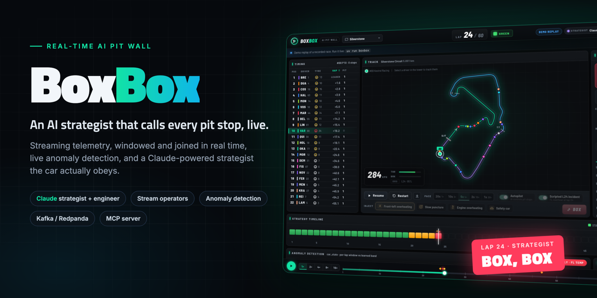
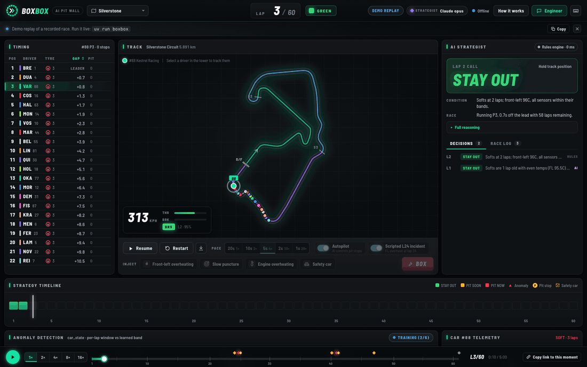
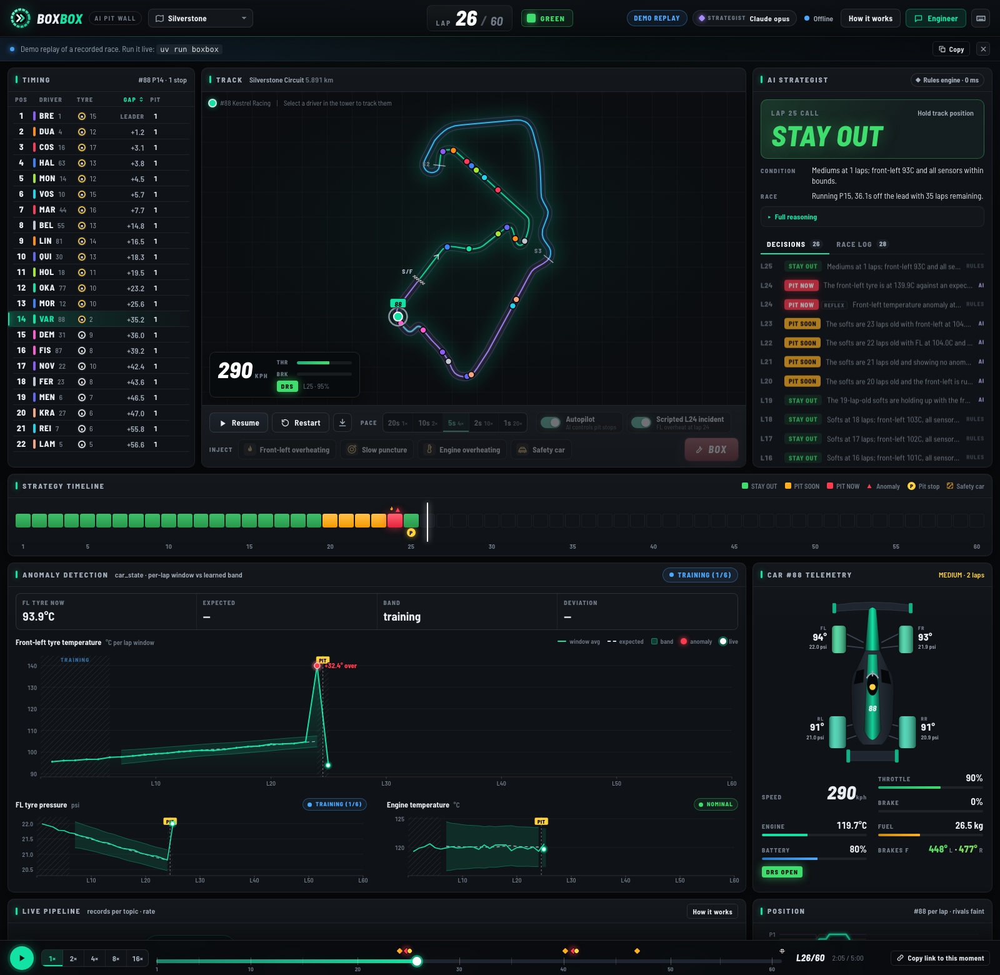
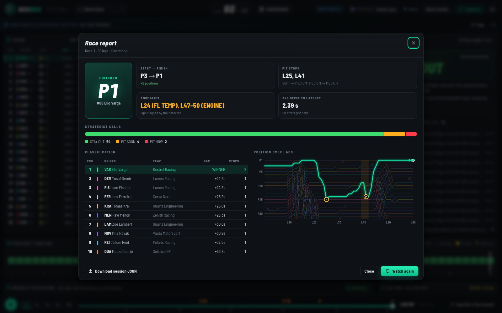
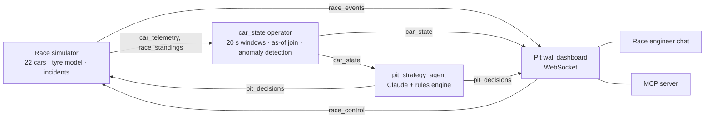
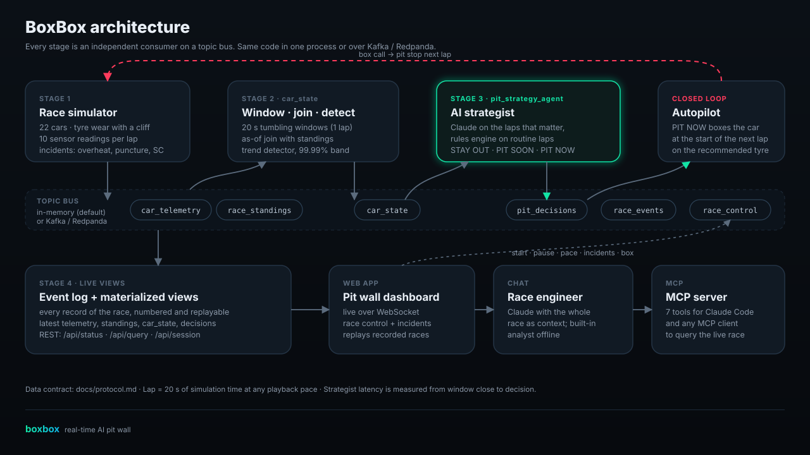

<div align="center">



# BoxBox

**A real-time AI pit wall.** Live race telemetry streams through a windowing, anomaly-detecting pipeline; an AI strategist calls every pit stop as it happens, and the car obeys.

[](https://github.com/vnmoorthy/boxbox/actions/workflows/ci.yml)
[](https://vnmoorthy.github.io/boxbox/)
[](https://www.python.org/)
[](LICENSE)

**[Try the live demo](https://vnmoorthy.github.io/boxbox/)** · [Quick start](#quick-start) · [How it works](#how-it-works) · [Architecture](#architecture) · [API](#web-api)

</div>

---

> *"Box, box."* In Formula 1 that's the radio call to pit this lap. Get it a lap late and the tyre lets go; a lap early and you hand away track position. BoxBox is a pit wall where that call is made by an AI agent reading a live stream, and you can throw problems at the car to see how it reacts.



## What it does

- **Simulates a 60-lap race** with 22 cars, tyre wear with a cliff, pit stops, overtakes and a safety car. Your car, #88, streams 10 sensor readings per lap.
- **Processes the stream like a real pipeline.** A `car_state` operator cuts telemetry into 20-second event-time windows (one lap), joins each reading with the standings as of that moment, and averages the sensors.
- **Detects anomalies as they happen.** A stint-aware trend detector forecasts each signal from the current stint and flags values outside a 99.99% band: front-left tyre temperature, front-left pressure, engine temperature.
- **Lets an AI agent make the call.** The strategist reads every lap and answers `STAY OUT`, `PIT SOON` or `PIT NOW`, with a tyre, a stint length and its reasoning. Claude handles the laps that matter; an instant rules engine handles routine laps and takes over if Claude is unavailable.
- **Thinks at two speeds.** On an incident lap a rules **reflex** answers in about a millisecond so the car can react, while Claude deliberates; Claude's **final** call for the same lap follows with full reasoning. A slow model never costs the car a lap.
- **Closes the loop.** With autopilot on, a `PIT NOW` boxes the car at the start of the next lap on the recommended tyre.
- **Lets you break things.** Inject a front-left overheat, a slow puncture, an engine overheat or a safety car from the dashboard and watch the detector and the strategist respond.
- **Answers questions.** A race engineer chat (Claude, or a built-in analyst offline) knows the whole race: *"Why did we pit?"*, *"What happens if we stay out?"*, *"What happened on lap 24?"*
- **Plugs into your coding agent.** An MCP server exposes the live race to Claude Code or any MCP client.
- **Scales out.** Every stage is an independent consumer on a topic bus: in-memory by default, or Kafka / Redpanda with one process per stage.



## Quick start

You need [uv](https://docs.astral.sh/uv/). It installs Python 3.11+ and the dependencies on first run. No API key, account or cloud service is required.

```bash
git clone https://github.com/vnmoorthy/boxbox.git
cd boxbox
uv run boxbox
```

Your browser opens the pit wall at http://localhost:8088. Press **Start race**.

**Give the strategist Claude** (optional; without it the rules engine makes every call):

- Set `ANTHROPIC_API_KEY`, or
- have [Claude Code](https://claude.com/claude-code) installed and signed in. BoxBox detects the `claude` CLI and uses it with tools, MCP servers and plugins turned off.

`uv run boxbox doctor` shows what BoxBox found on your machine.

### Things to try

| Do this | What happens |
|---|---|
| Let the race run to lap 24 | The front-left overheats past 140°C. Within the lap the detector flags it, the strategist calls **PIT NOW**, and the car boxes for mediums. |
| **Slow puncture** | Front-left pressure falls about 1.6 psi a lap. The pressure detector catches it and the strategist boxes the car. |
| **Engine overheating** | Engine temperature is flagged, but a pit stop can't fix an engine: the strategist stays out and tells the driver to lift-and-coast. |
| **Safety car** | The field bunches and a stop costs half as much. Watch the strategist take the cheap stop for fresh tyres. |
| Turn **autopilot** off | The strategist still calls PIT NOW, but the car stays out until the driver gives up on the tyre a few laps later. Compare the result. |
| **Box** with a compound | You're the engineer: force a stop on the tyre you choose. |
| Ask the **engineer** | *"Why did we pit?"* · *"How are the tyres?"* · *"Summarize the race so far."* |

Keyboard: `Space` pause/resume · `B` box · `1`–`5` pace · `E` engineer · `H` how it works · `?` all shortcuts.

When the flag drops you get a race report: result, stops, anomalies, every strategy call and the position chart.



## How it works



| Stage | Consumes | Produces | What it does |
|---|---|---|---|
| **Simulator** | `race_control`, `pit_decisions` | `car_telemetry`, `race_standings`, `race_events` | Runs the race; obeys commands; boxes the car on `PIT NOW` (autopilot). |
| **car_state** | `car_telemetry`, `race_standings` | `car_state` | Tumbling 20 s event-time windows; as-of join with standings; averages; anomaly detection. |
| **pit_strategy_agent** | `car_state` | `pit_decisions` | One call per lap from Claude or the rules engine, with latency measured from window close. |
| **Dashboard** | everything | REST, WebSocket, MCP | Event log + materialized views; serves the web app, the engineer and the MCP tools. |

**Event time, not wall time.** One lap is always 20 seconds of simulation time, whatever the playback pace (1× to 20×), so windows, joins and the detector see the same stream at any speed.

**The detector.** For each signal, a linear-trend model is refit on every window from the current stint's clean history (at most 50 windows, at least 6). It predicts the next value with a 99.99% prediction interval and flags values outside it on the watched side. Flagged windows aren't learned, so a sustained fault stays flagged; history resets at pit stops for the tyre signals; safety-car laps are scored but not learned.

**The strategist.** One prompt and one 7-line answer format serve both brains. In `hybrid` mode (the default with Claude), Claude handles lap 1, every 10th lap, the pit window, anomalies and the safety car; the rules engine handles routine laps. Each decision records which brain made it and how long it took. See [`agents/prompt.py`](src/boxbox/agents/prompt.py) for the decision framework.

**Two speeds, no backlog.** An LLM answer takes seconds; a lap can take one. So on incident laps the rules engine publishes a `reflex` decision immediately (the autopilot acts on it) and Claude's `final` decision for the same lap follows. Claude's queue is prioritised: incident laps jump ahead, and a routine lap that's still waiting when a newer lap arrives is settled by the rules engine instead. In testing, a strategist taking four laps to answer still boxed the car the lap after the incident.

The full data contract (every topic, record and API) is in [docs/protocol.md](docs/protocol.md).

## Architecture



### Run each stage as its own process

The same stages run over any Kafka-compatible broker. With Docker:

```bash
docker compose up --build        # Redpanda + simulator + car_state + strategist + dashboard
```

Or run the broker in Docker and the stages yourself:

```bash
docker compose up -d redpanda
uv run --extra kafka boxbox --broker localhost:9092 --role dashboard
uv run --extra kafka boxbox --broker localhost:9092 --role processor
uv run --extra kafka boxbox --broker localhost:9092 --role agent
uv run --extra kafka boxbox --broker localhost:9092 --role sim
```

### Ask your coding agent about the race (MCP)

With BoxBox running, register its MCP server with Claude Code:

```bash
claude mcp add boxbox -- uv run --directory "$PWD" --extra mcp boxbox mcp
```

Then ask Claude Code things like *"What's the front-left temperature on car 88 right now?"* or *"Why did the strategist call PIT NOW?"*. Tools: `race_status`, `standings`, `car_state`, `pit_decisions`, `telemetry`, `race_events`, `ask_race_engineer`.

## CLI

| Command | What it does |
|---|---|
| `boxbox` | Run everything in one process and open the dashboard. |
| `boxbox --pace 2 --autostart` | 2 s per lap, start racing immediately. Paces: 20, 10, 5, 2, 1 s/lap. |
| `boxbox --strategist rules` | Offline: the rules engine makes every call. Also `hybrid`, `claude`. |
| `boxbox --llm claude-cli --model claude-opus-5-5` | Choose the Claude backend (`anthropic`, `claude-cli`, `none`) and model. |
| `boxbox --no-autopilot` / `--no-scripted-incident` | The car ignores PIT NOW / no lap-24 overheat. |
| `boxbox --broker HOST:PORT --role ROLE` | Run one stage (`sim`, `processor`, `agent`, `dashboard`) over a broker. |
| `boxbox record --out race.json --scenario 40:safety_car` | Record a full race headlessly into a replay file. |
| `boxbox mcp` | MCP server over stdio for a running dashboard. |
| `boxbox doctor` | Show the Claude backends, broker client and MCP support available. |

## Web API

Interactive docs at http://localhost:8088/api/docs.

| Endpoint | |
|---|---|
| `GET /api/status` | Race state, settings, agent, pipeline counts and rates, capabilities. |
| `POST /api/control` | `start`, `pause`, `resume`, `restart`, `speed`, `scenario`, `box`, `autopilot`, `scripted_incident`. |
| `POST /api/engineer` | Ask the race engineer: `{"question": "...", "history": [...]}`. |
| `GET /api/query?topic=car_state&lap=24` | Latest rows from a topic's view. |
| `GET /api/session` | The current race as a replay file. |
| `WS /ws` | `hello` (status + every event so far), then live `events` and `status`. |

## Replays and the web demo

Every race is an ordered event log. `GET /api/session` or `boxbox record` saves one; the web app replays it with play, pause, speed and seek when no server is running. That's how the [live demo](https://vnmoorthy.github.io/boxbox/) works on GitHub Pages: a 60-lap race recorded with Claude as the strategist, including a lap-24 overheat, a lap-40 safety car and a lap-47 engine overheat.

Deep links jump to a moment, such as [the lap-24 PIT NOW](https://vnmoorthy.github.io/boxbox/?lap=24).

## Project layout

```
src/boxbox/
  sim/        race physics, grid, incidents, telemetry, the simulator stage
  stream/     car_state operator and the anomaly detector
  agents/     strategist prompt, rules engine, Claude backends, race engineer
  bus/        in-memory and Kafka buses
  server/     live views and the FastAPI app
  web/        the dashboard (no build step) and the demo replay
  mcp_server.py, record.py, cli.py, pipeline.py
tests/        full races through the pipeline, the API, the detector and the rules
docs/         protocol and architecture
```

## Development

```bash
uv run pytest                       # backend: full races, API, detector, strategist
node src/boxbox/web/js/selftest.mjs # web app: reducer, replay, analyst
uv run ruff check src tests
```

## Acknowledgements

- The race physics and the race-strategy idea grew out of an Apache-2.0 licensed streaming quickstart; BoxBox replaces its cloud pipeline with its own stream operators, detector, agents and app.
- Circuit outlines: [bacinger/f1-circuits](https://github.com/bacinger/f1-circuits) (MIT).
- Teams and drivers are fictional. BoxBox isn't affiliated with Formula 1 or any team.

## License

[Apache-2.0](LICENSE)
